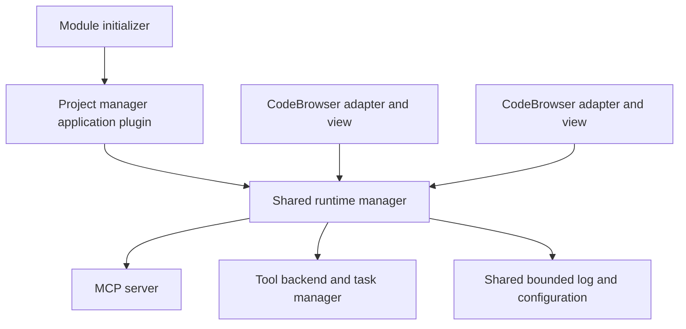

# GhidrAssistMCP modernization review

Reviewed against the available Ghidra 12.0/12.1 installations and current MCP/SDK documentation on 2026-10-09.

GhidrAssistMCP now exposes an explicit operation catalog and an application-owned server that starts with Ghidra's project manager. The previous 49 registered definitions have been reviewed individually. The public catalog now contains 100 contracts; 93 are enabled by default, including four project lifecycle operations. Shared implementation classes avoid duplicating Ghidra logic, while operation-specific schemas and annotations improve tool discovery and distinguish reads from writes.

## Naming decisions

Use `get_*` for a specific object or representation, `list_*` for collections, `search_*` for filtered discovery, and an explicit mutation verb for edits. Names carry the user's intent instead of requiring the model to discover a format/action selector. Related parameters remain together when they refine one operation, such as a search pattern or graph depth.

`get_pseudocode`, `get_disassembly`, and `get_pcode` select their implementation format internally. `get_disassembly` reads existing instructions; `disassemble_bytes` defines instructions and changes the program listing. `get_function_info` reads metadata and a prototype; `analyze_program` runs Auto Analysis. Memory segments are called `list_memory_blocks`, matching Ghidra's memory model.

The old `get_function_signature` returns a masked prefix pattern rather than a C declaration or digest. Its existing output is preserved as `get_function_byte_pattern`. A new `get_function_hash` computes SHA-256 over all body bytes in ascending address-range order, and `get_function_prototype` reads the C declaration. Exact-byte hashes change when bytes change; the separate masked pattern remains useful for relocation-tolerant matching.

Function selectors use `function` on the representation, prototype, hash, metadata, and local-variable tools. Program-specific operations accept `program_name`, with full project paths preferred. Cursor tools use the focused CodeBrowser's UI context. Project tools and task operations do not acquire an unrelated program selector. `import_file.program_name` remains the requested imported name, preserving that original contract.

## Complete review of the previous catalog

Every previous registered tool is included below. Parenthesized operations name internal selectors, which are absent from the public schema. The old `types.create_struct` operation shares `create_structure`, and `open_program.list` is replaced by `list_project_files` with `recursive=true`, avoiding duplicate catalog entries. The previous `rename_symbol` variable operation maps to `rename_local_variable`. Batch renaming remains one tool because it expresses one coherent edit intent and reports results per item.

| Previous tool | Public tool or tools |
| --- | --- |
| `get_binary_info` | `get_program_info` |
| `list_binaries` | `list_open_programs` |
| `get_functions` | `list_functions` |
| `analyze_function` | `get_function_info` |
| `get_function_signature` | `get_function_byte_pattern` |
| `get_segments` | `list_memory_blocks` |
| `get_imports` | `list_imports` |
| `get_exports` | `list_exports` |
| `get_strings` | `list_strings` |
| `get_data_vars` | `list_data_variables` |
| `get_namespaces` | `list_namespaces` |
| `get_relocations` | `list_relocations` |
| `get_current_address` | `get_current_address` |
| `get_current_function` | `get_current_function` |
| `get_data_at` | `get_hexdump` |
| `comments` | `get_comment (get)`, `get_function_comment (get)`, `list_function_comments (list)`, `set_comment (set)`, `set_function_comment (set)`, `remove_comment (remove)` |
| `variables` | `list_function_variables (list)`, `rename_local_variable (rename)`, `rename_global_variable (rename)`, `set_local_variable_type (retype)`, `set_function_prototype (set_prototype)` |
| `types` | `list_data_types (list)`, `get_data_type (get)`, `set_data_type (set)`, `create_enum (create_enum)`, `create_typedef (create_typedef)`, `delete_data_type (delete)` |
| `xrefs` | `get_xrefs_to`, `get_xrefs_from`, `get_callers`, `get_callees`, `get_call_graph` |
| `struct` | `create_structure (create)`, `replace_structure (modify)`, `merge_structure (merge)`, `set_structure_field (set_field)`, `name_structure_gap (name_gap)`, `infer_structure_from_variable (auto_create)`, `rename_structure_field (rename_field)`, `get_structure_field_xrefs (field_xrefs)` |
| `get_code` | `get_pseudocode`, `get_disassembly`, `get_pcode` |
| `get_basic_blocks` | `get_control_flow_graph` |
| `rename_symbol` | `rename_function`, `rename_label` |
| `batch_rename` | `rename_symbols_batch` |
| `search_bytes` | `search_bytes` |
| `bookmarks` | `list_bookmarks (list)`, `set_bookmark (set)`, `remove_bookmark (remove)` |
| `classes` | `list_classes (list)`, `get_class_info (get_info)` |
| `search_functions_by_name` | `search_functions` |
| `get_function_statistics` | `get_program_function_statistics` |
| `get_function_stack_layout` | `get_function_stack_layout` |
| `search_strings` | `search_strings` |
| `create_data_var` | `create_data_variable` |
| `create_function` | `create_function` |
| `disassemble_at` | `disassemble_bytes` |
| `get_entry_points` | `list_entry_points` |
| `open_program` | `open_program (open)` |
| `close_program` | `close_program` |
| `project_files` | `list_project_files (list)`, `delete_project_file (delete)`, `delete_project_folder (delete)` |
| `assemble_code` | `assemble_instructions`, `patch_instructions` |
| `patch_bytes` | `patch_bytes` |
| `analysis_options` | `list_analysis_options (list)`, `set_analysis_options (set)`, `reset_analysis_options (reset)`, `save_analysis_preset (save_preset)`, `apply_analysis_preset (apply_preset)`, `list_analysis_presets (list_presets)`, `delete_analysis_preset (delete_preset)` |
| `analyze_program` | `analyze_program` |
| `analysis_control` | `get_analysis_status (status)`, `cancel_analysis (cancel)` |
| `import_file` | `import_file` |
| `scripts` | `list_scripts (list)`, `get_script_source (get)`, `create_script (create)`, `delete_script (delete)`, `run_script (run)` |
| `export_program` | `export_program` |
| `get_task_status` | `get_task_status` |
| `cancel_task` | `cancel_task` |
| `list_tasks` | `list_tasks` |

Additional tools: `get_function_hash`, `get_function_prototype`, and the four project lifecycle tools below. Each returns structured results with a declared output schema.

## Application lifecycle and ownership

Ghidra binds plugin adapters and UI providers to individual PluginTools. Each CodeBrowser therefore has its own adapter and view over the same application runtime, rather than sharing a literal Plugin object between windows.

A `ModuleInitializer` attaches the application plugin when the front-end window is ready. It also handles existing saved Ghidra profiles that do not yet include the application plugin. Headless startup skips this hook and retains the explicit headless launcher.

The application plugin tracks project events and CodeBrowsers, attaching their views automatically. The manager owns the backend, HTTP server, configuration, and bounded log. Automatic MCP view attachment preserves the tool's existing configuration-dirty flag, so attaching the shared view does not itself prevent safe project closure. Closing the first or last CodeBrowser leaves the runtime available while the project manager remains open. Saving configuration refreshes all views; clearing the log clears the shared log. Browser focus is tracked through the tool window rather than only through focus on the MCP tab.

`open_program` resolves an exact project path or unique filename, loads the program outside the Swing event thread, then launches or reuses CodeBrowser through public Ghidra APIs. ProgramManager operations run on the event thread. Full paths disambiguate duplicate names; unknown or ambiguous selectors return errors. Runtime startup and shutdown use a serial background executor, including replacement runtimes, to avoid port-binding races.

## Project lifecycle tools

Four new public tools complete project-manager control without requiring a CodeBrowser or loaded program:

| Tool | Arguments | Behavior |
| --- | --- | --- |
| `create_project` | Required `location` (existing absolute parent directory), `name` (simple stem without `.gpr`/`.rep`) | Create and activate a local project; never overwrite or replace another active project. |
| `open_project` | Required `path` (absolute existing `.gpr` marker), optional `restore_state=false` | Activate the exact project; an already active matching project returns `already_open`. A different active project must be closed first. |
| `save_project` | None | Save changed open project files and session state, returning the confirmed `saved_files` count. |
| `close_project` | Optional `save=false`, `discard_changes=false` | Close the active project and its tools. Unsaved changes require saving or explicit discard; the options are mutually exclusive. No active project returns `already_closed`. |

All four expose mutation annotations, omit `program_name`, execute synchronously, and disable caching. Close carries a destructive annotation because explicit discard can lose unsaved data. Create is non-idempotent; opening an already active project, saving, and closing an already closed project are idempotent. Successful receipts include `status` and available project `name`, `location`, `project_path`, `saved_files`, and `discarded_changes` fields.

`ProjectControlTool` validates the public contracts and delegates to `project/ProjectController`. The GUI implementation uses the application-owned `FrontEndTool` and public Ghidra project APIs. Activating a project updates the frontend and emits its normal project event, so the application plugin follows new workspaces and browsers. Closing a project leaves that frontend owner and the server alive. The headless launcher retains responsibility for its own project lifecycle.

Ghidra's project-state save API alone writes session metadata rather than dirty program data. The controller saves changed open domain files through checked Ghidra file-save APIs before saving session state. Failures return tool errors with partial-save details, and a failed save prevents project closure. The backend uses a fail-fast project-operation gate for tools, resource reads, prompts, and asynchronous workers. A transition refuses concurrent MCP work, including cancelled tasks whose workers have not finished releasing program consumers. Program database operations remain protected from concurrent MCP lifecycle transitions. Running tool commands and busy domain-object locks prevent saving or closing, including explicit discard. Unsaved tool configuration must be saved in Ghidra before safe closure; remaining plugin unsaved-data flags also prevent safe closure after a project save. `discard_changes=true` permits dropping these unsaved states.

The GUI controller writes one private project SaveState checkpoint (`GhidrAssistMCP.ProjectControl`) and verifies its persistence in the host's project-state file. This detects failed metadata writes that Ghidra's void save API otherwise reports only through a dialog. The verification uses the JDK XML parser to avoid differences in host-provided XML libraries. It follows the Ghidra 12.0/12.1 file layout and needs coverage when supported host versions change. The final close step also rechecks the active project, open-data membership, and busy files on the event thread. Plugin-specific close veto callbacks are outside the public command, data, and configuration guards used here; GUI acceptance must still cover installed plugins.

## MCP protocol and execution contracts

The server uses stable Java SDK 2.0.1. Streamable HTTP at `/mcp` is the primary endpoint; `/sse` and `/message` provide compatibility with existing clients. Streamable HTTP negotiates `2025-11-25`; legacy SSE retains `2024-11-05`. The dependency build excludes historical copies from generated `lib/`. The selected SDK, Jackson, schema validator, Jetty, Servlet, Reactor, and logging dependencies are packaged together under private `ghidrassistmcp.internal.*` names, avoiding collisions with Ghidra's older JSON/logging libraries and other extensions. A subprocess regression loads the distributed jar after the original host libraries and exercises HTTP discovery and tool calls.

The HTTP container moves to the supported Jetty 12.1 line with EE11 servlet support. Jetty 11 has reached end of life; see [Jetty support](https://jetty.org/support.html) and the [Jetty 12.1 documentation](https://jetty.org/docs/jetty/12.1/index.html).

The stable Java SDK implements MCP `2025-11-25`. The latest specification is `2026-07-28`, which introduces stateless self-contained requests and per-request negotiation. The Java SDK roadmap assigns that revision to its next major line. This implementation does not claim support for that protocol revision. See the [MCP specification](https://modelcontextprotocol.io/specification/2026-07-28) and [Java SDK roadmap](https://github.com/modelcontextprotocol/java-sdk/blob/main/ROADMAP.md).

Input schemas are validated before execution. Reads and edits have separate annotations, selectors hidden by the catalog cannot be overridden, and missing required fields fail visibly. Operation failures set `isError`. Adding context preserves the result's structured content, metadata, error flag, and non-text content. JSON result text can also populate structured content; legacy human-readable results retain their existing presentation.

The transport retains its SDK servers and refreshes their tool registrations when configuration changes, allowing tool-list changes without a transport restart. URI patterns are registered as resource templates, and resource reads resolve the program encoded in their URI rather than using whichever binary has focus.

The backend acquires program leases for operations that require a program and retains target programs across custom asynchronous jobs. A queued task releases its lease if cancelled before execution; a running task retains its lease until its worker finishes. Failure and shutdown paths release consumers once. The worker queue is bounded to 128 pending jobs; rejected jobs release their consumers immediately. The code-retrieval decompiler receives a cancellation-aware monitor, and hashing checks cancellation between memory chunks. Auto Analysis with `scope=all_open` works when the focused browser has no current program. It snapshots the open targets when its worker starts and retains every target before analysis; acquisition failures and analysis failures release all retained consumers and return tool errors.

Cache identity includes the program instance and project/file identity rather than only a filename. Successful raw results are cached only while the program revision remains stable, and response context is added when the result is returned. This prevents duplicate-name collisions, stale focus headers, and cached failures.

The three job tools (`list_tasks`, `get_task_status`, `cancel_task`) remain a documented application job API. They do not advertise the protocol's Tasks extension. Native task negotiation, progress notifications, and complete result schemas for every existing text-based tool are further work.

## Migration and client alignment

This catalog and lifecycle change is released as **3.0.0**, following the previous `2.11.0` release. MCP server metadata, package filenames, and jar manifests carry the product version. Ghidra's `extension.properties.version` retains the host compatibility version (`12.0` or `12.1`).

Clients must refresh `tools/list` or reconnect and use the new public names. Old consolidated names are absent from HTTP discovery and call handlers. Internal backend aliases help existing code paths and persisted settings; they do not constitute wire-level backwards compatibility. Original disabled settings fan out to the corresponding public operations, and existing per-tool settings migrate to application preferences.

The original host filesystem and script opt-ins are preserved: `import_file`, `export_program`, and the five script operations are disabled by default. Splitting those operations does not add new execution capabilities.

GhidrAssist and GhidrAssistHL discover tool definitions dynamically, so their client sources do not need renamed function calls for this catalog change. Their optional context-injection helper is unused by the current integration. BinAssistMCP and IDAssistMCP still expose consolidated names; a separate coordinated migration should reuse these naming rules and shared parameter conventions while preserving each host's capabilities. No SymGraph push/pull or ontology contract changes are needed for this pass.

## Further improvements

1. Add `get_string` to return complete string content at an address; existing string lists/searches shorten display values. Add pagination for bookmarks and a node/edge budget for call graphs.
2. Convert collection results to typed records with stable cursor pagination, `truncated`, and `next_cursor` fields. This is especially useful for strings, references, large functions, and structure-field searches.
3. Add `get_current_context` to atomically return the program, browser, function, cursor, and selection. Add `navigate_to_address` as a clear UI navigation operation.
4. Add explicit `save_program` and dirty-state inspection so annotation changes have predictable persistence before a client closes a program.
5. Adopt native MCP Tasks/progress where client capabilities support them, retaining the application job API for older clients.
6. Move to the Java SDK line implementing `2026-07-28` when supported, with protocol-version integration tests and a client compatibility matrix. Keep all Ghidra operations behind the existing backend boundary.
7. Evaluate catalog selection against the previous names using a fixed benign fixture and natural-language tasks such as “show the pseudocode,” “list callers,” and “change a local variable type.” Measure first-call selection, argument validity, and successful completion. Naming quality is a design choice here, not a measured model-performance claim.
8. Normalize masked byte-pattern wildcard syntax with `search_bytes`: the preserved signature format uses single `?` tokens, while byte search expects `??` or `**`. Add unambiguous variable/function identities for mutations rather than relying on duplicate display names.
9. Bring the three MCP companions into alignment through a shared contract table and matching fixture tests, including host-specific deviations.

## Validation

Automated tests cover catalog contracts, project-tool path/argument validation and controller dispatch, project creation/opening policies, checked file and metadata saves, partial-save failures, unsaved/busy close guards, lifecycle exclusion and cancellation cleanup, real Streamable HTTP and legacy SSE initialization/discovery/calls with no program loaded, dynamic tool availability, program selection, result preservation, cache identity, bounded shared logging, function hashing, and task consumer cleanup. The packaged subprocess also checks that the SDK/JSON/HTTP classes originate from the private runtime jar, both with Ghidra 12.0's older shared Jackson loaded first and with Ghidra 12.1's host libraries.

| Check | Result |
| --- | --- |
| Ghidra 12.0 `buildExtension test` | 90 tests passed; version-specific ZIP built |
| Ghidra 12.1 `buildExtension test` | 90 tests passed; version-specific ZIP built |
| Streamable HTTP and legacy SSE | Initialization and explicit discovery passed without a program |
| Runtime isolation | Packaged server passed against each host classpath; ZIP contains one private jar and no Ghidra classes |
| Package hygiene | Local analysis databases, editor settings, Lucene state, and unused language skeleton files excluded |
| Project lifecycle HTTP errors | Missing GUI ownership returns tool errors without stopping the server |
| Diff whitespace check | Passed |
| Live Ghidra 12.1 startup and multiple CodeBrowser views | Passed through the connected MCP server; matching logs confirmed in both windows |

Builds used Java 25.0.4.1 and Gradle 9.6.1. The installed Ghidra libraries were not changed.

The four project-control tools were added after the live smoke test below and have not yet been exercised against the installed GUI. Remaining GUI acceptance should cover their create/open/save/close round trip, both a fresh and an existing saved profile, shared configuration edits, and shutdown with a running task. The broader acceptance sequence is: connect before opening CodeBrowser, list project files, open a program, open a second CodeBrowser, compare logs and configuration, close the first and then all browsers, close/reopen the project, and shut down with a running task. The server should remain reachable until the application closes or the user disables it.

### Live Ghidra 12.1 smoke test — 2026-10-09

The user installed 3.0.0 and began with only the project manager open. Tests used the active Ghidra MCP connection.

- Project access worked with no CodeBrowser: list_open_programs returned an empty list, recursive list_project_files returned existing project entries, and get_pseudocode returned isError=true with opening instructions.
- The connected catalog at that time contained 89 enabled tools (before the project lifecycle additions), including get_disassembly, get_pseudocode, get_pcode, get_function_hash, get_function_byte_pattern, and get_function_prototype. The old get_code and get_function_signature names were absent.
- open_program launched CodeBrowser for an existing analyzed PowerPC program. Tests passed suppress_analysis_prompt=false and analyze_after_open=false; Auto Analysis remained idle.
- Disassembly, pseudocode, grouped and raw P-code, byte patterns, prototypes, function metadata, and paginated function lists succeeded. Repeated pseudocode output was consistent.
- A function hash covered the reported 228-byte body range. An independent Python SHA-256 calculation over get_hexdump bytes matched the returned digest. Repeating the request by function name produced the same digest.
- Missing project files, missing functions, nonexistent explicit program paths, duplicate project filenames, and duplicate open-program names returned isError=true. Invalid byte counts and old format selectors were rejected by schema validation.
- The user opened a second CodeBrowser with an 8051 program. Both programs had the internal name payload.bin; full project paths routed to the correct architecture, and focused cursor context and CODE-space function reads worked. The user confirmed identical request logs in both panels.
- After the user closed both CodeBrowsers, MCP remained reachable, project listing still worked, and code requests correctly reported no open program.
- Discovery returned all six resource templates. Dynamic resource reads, successful asynchronous-job submission/polling, settings propagation, fresh-profile startup, project close/reopen, and shutdown with running tasks were outside this smoke pass.

No analysis, patches, annotations, imports, script execution, or saves were requested. The smoke test exposed stale selector guidance in project-opening and structure errors; the source now names the explicit tools. The running installation was not replaced during testing.
